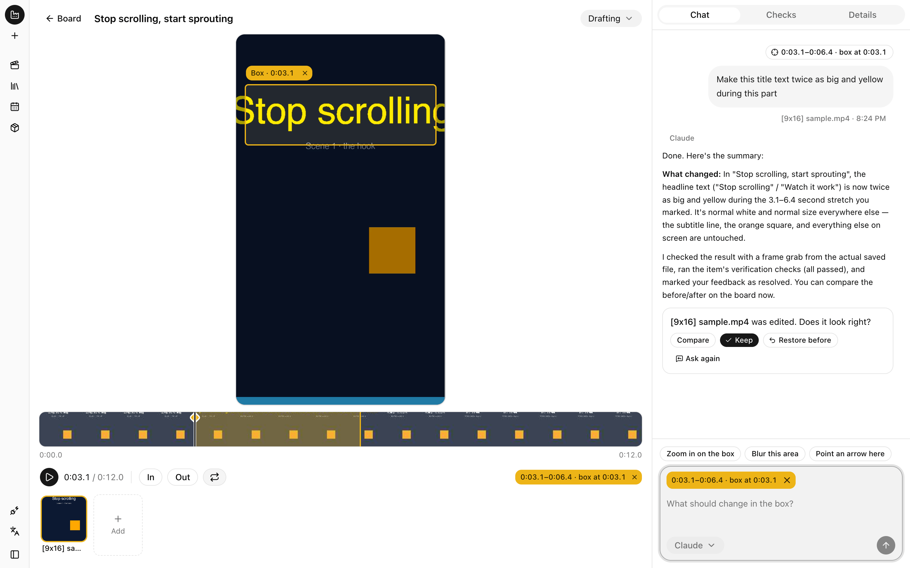
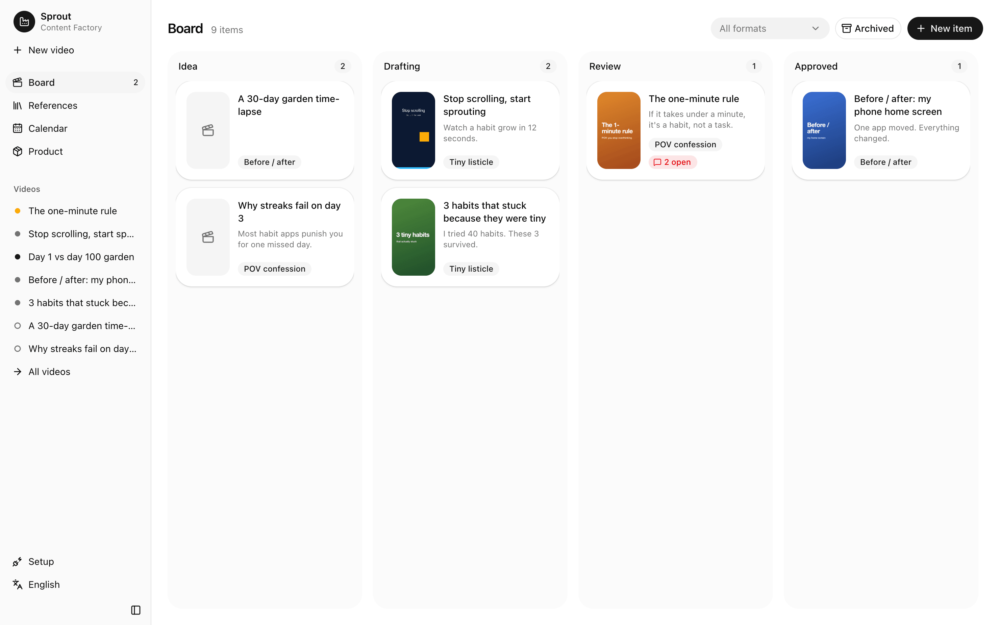
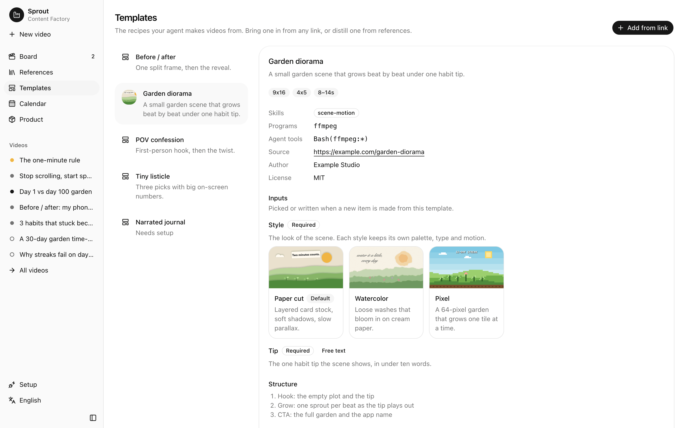

<p align="center">
  <picture>
    <source media="(prefers-color-scheme: dark)" srcset=".github/assets/logo-dark.svg">
    
  </picture>
</p>

<h1 align="center">Content Factory</h1>

<p align="center">
  <a href="LICENSE"></a>
  
  
  
</p>

<div align="center">
  <strong>
    Content Factory is a local-first studio for short-form marketing videos, made for solo developers who market their own app. Your own coding agent does the work, and you review it on a board.
    <br /><br />
    Get the signed Mac app, or build the open-source edition yourself.
  </strong>
</div>

<p align="center">
  <br />
  <a href="#quick-start"><strong>Quick start »</strong></a>
  <br /><br />
  <a href="docs/architecture.md">Architecture</a>
  ·
  <a href="https://github.com/w00ing/content-factory/issues">Issues</a>
  ·
  <a href="https://wyverselabs.com">Wyverse Labs</a>
</p>

<p align="center"><strong>Made for:</strong></p>
<p align="center">
  
  
  
</p>

<p align="center"><strong>With your own agent:</strong></p>
<p align="center">
  
  
  
</p>

<br />

<p align="center">
  <picture>
    <source media="(prefers-color-scheme: dark)" srcset=".github/assets/editor-dark.png">
    
  </picture>
</p>

## ✨ Features

- **Point at what to change.** Drag across the timeline to pick a part, draw a box on the video, and
  say what should change. Your agent edits the file, then you compare before and after and keep it
  or restore the old one.
- **One board for every post.** Each video moves from idea to drafting, review, approved, scheduled
  and published, with timecoded feedback and upload checks along the way.
- **References in, formats out.** Drop a video or paste a URL. The factory pulls scene cuts, hook
  frames, a contact sheet and the audio, your agent writes the analysis, and the patterns that work
  become reusable formats.
- **Agents check their own work.** Your agent writes a brief and shot list for you to okay before
  it renders, then looks at the frames it made, every cut included, and fixes the biggest problems
  first.
- **Templates from any link.** Paste a post, a repo or an Agent Skill and the board runs your agent
  on it, turning it into a template with its own inputs and previews. The agent can only read until
  you press Allow, and the board shows what each template still needs. See
  [docs/templates.md](docs/templates.md).
- **Your product in every run.** Import positioning and screenshots from an App Store, Google Play
  or landing page URL. Every agent run reads it, so hooks and CTAs stay on message.
- **Calendar and metrics.** Plan each post per platform, then log views, likes and comments after it
  goes out.
- **Bring your own agent.** Claude Code and Codex connect through the built-in MCP server and run
  on your machine, with the model and reasoning effort you pick in the chat. Without one, "Copy
  prompt" hands the request to any agent you like.
- **Files, not a database.** A workspace is plain folders and YAML, so it works with Git, Finder and
  your editor.
- **English and Korean.**

<p align="center">
  <picture>
    <source media="(prefers-color-scheme: dark)" srcset=".github/assets/board-dark.png">
    
  </picture>
</p>

<p align="center">
  <picture>
    <source media="(prefers-color-scheme: dark)" srcset=".github/assets/templates-dark.png">
    
  </picture>
</p>

## Mac app vs. open source

The Mac app, Content Factory Solo, is built from this repository. Both have the same features, and
we don't lock any of them behind a license key. Paying gets you a signed build that updates itself,
plus content we prepare for you.

| Area                                                         | Solo (Mac app)                                    | Open source (this repository)                  |
| ------------------------------------------------------------ | ------------------------------------------------- | ---------------------------------------------- |
| **Cost**                                                     | $19/month or $180/year, 7-day free trial          | Free forever (AGPL-3.0)                        |
| **Setup**                                                    | Download a signed app and open it                 | Install Bun and ffmpeg, then build it          |
| **Updates**                                                  | Install themselves                                | Pull and rebuild                               |
| **Board, editor, references, formats, calendar, MCP server** | Included                                          | Included                                       |
| **Agents**                                                   | Your own Claude Code or Codex, on your machine    | Your own Claude Code or Codex, on your machine |
| **Reference feed and format packs**                          | Included once they ship                           | Not included                                   |
| **Data**                                                     | Plain folders on your Mac                         | Plain folders on your machine                  |
| **If you stop paying**                                       | The app keeps working at the last version you had | Not applicable                                 |
| **Source and changes**                                       | Built from this repository                        | Fork and modify under the AGPL-3.0             |

## Privacy

- This repository is the open-source edition of Content Factory. The Mac app is built from the same
  code.
- Your workspace stays on your disk. There's no account and no telemetry, and your videos and files
  are never uploaded.
- Agents run on your machine with your own Claude Code or Codex login. Content Factory never asks
  for, stores or forwards your API keys.
- The server listens on `127.0.0.1` unless you pass `--host`.
- It only goes online when you ask it to: importing a product page, fetching a URL reference with
  your own `yt-dlp`, or opening the feedback form.
- Study references you're allowed to download, and don't repost other people's videos.

## Tech stack

- [Bun](https://bun.sh) for the runtime, server, tests and the compiled sidecar
- [Effect](https://effect.website) v4 for the core and the server
- React 19, Vite, Tailwind CSS v4 and [shadcn/ui](https://ui.shadcn.com), with the React Compiler
- Electron for the Mac app
- ffmpeg and ffprobe for media, with optional `yt-dlp` and `whisper`
- oxlint and oxfmt

## Requirements

Bun 1.3+, ffmpeg/ffprobe. Optional: `yt-dlp` (URL references), `whisper` (transcripts).

## Quick start

```sh
bun install && bun run build
bun src/cli.ts init ~/my-app-content --from https://yourapp.com
bun src/cli.ts serve --workspace ~/my-app-content       # http://localhost:4317
```

`init` connects your agents first, then fills the product. Claude Code gets a project-scoped
`.mcp.json` in the workspace, and Codex is registered through `codex mcp add` as
`content-factory-<workspace>`. `--from` accepts an App Store, Google Play, or landing page URL; store
links on a landing page are followed, and store screenshots land in `product/store/`. Without
`--from`, the web UI opens on a Setup page with the same two steps. Use `--no-connect` to only print
the agent commands, and `factory product import <url>` to refresh the product later. To adopt an existing folder of posts,
add a `factory.yaml` with `paths.items` pointing at it. Folders containing `POSTING.md` or
`STATUS.md` appear on the board, and an `item.yaml` is written on their first edit.

The workspace gets the `content-factory` skill in `.agents/skills/` and `.claude/skills/`. `serve`
and the MCP server bring it up to date when Content Factory changes it. A copy you edited is kept,
and your agent offers you the new version instead.

`serve` takes `--port` (default 4317), `--host` (default `127.0.0.1`), and `--web-dir` to serve a
web build other than `dist/web`.

## Editing a video

Open an item on the board. Drag across the timeline to select a part (or press `I` and `O` at the
playhead), drag on the video to mark an area, then type what should change and press Enter. A box
you draw opens a small request box right beside it, so you can ask about it without leaving the
frame. The server runs `claude -p` or `codex exec` in the workspace, one session per item, and
streams its steps into the chat. The agent gets a clip of the range, the frame with the box drawn
on it, the timecodes, and the original file. When it is done, compare before and after, then keep
the edit or restore the previous version. Without a connected agent, the request waits in the chat
and "Copy prompt" hands it to any agent you run yourself.

Press `+` in the chat to give the agent something to read whenever it works on the video: paste a
link or a folder or file path, or in the desktop app choose one from disk. They show as chips above
the message and are saved in `item.yaml` as `sources`. Next to the agent, pick the model and
reasoning effort it runs with; the choice is kept per agent in that browser, and each run names the
ones it used.

You don't have to wait for one request to finish before making the next. Requests made while the
agent is working line up behind its run and start in turn, each from the result of the one before.
Until its turn comes, a request can be edited or cancelled. Numbered pins on the frame and the
timeline show the requests still in play; click one to jump to it in the chat. If a run fails or
is stopped, the rest of the line holds until you press Continue or Cancel all.

Every change to an item can be undone: edits, rollbacks, and changes to its title, status, hook,
caption, or notes, which you can edit in place in the Details tab. The History tab lists the changes
to jump back to and every saved version of each file to preview or restore.

Shortcuts: `Space` play or pause, `I`/`O` set the start or end, `L` loop the selection, `←`/`→` step
a tenth of a second (`Shift` for a second), `Esc` clear, `⌘Z`/`⇧⌘Z` undo or redo a change to the
item (`Ctrl+Z`/`Ctrl+Y` elsewhere), and `?` shows them all.

## Desktop app

```sh
bun run desktop           # build the web UI and Electron shell, then open it
bun run dist:desktop      # unsigned macOS app in release/, with the server compiled as a sidecar
bun run release:desktop   # signed and notarized release, published to the update feed
```

The app runs the same server as `factory serve` as a sidecar on `127.0.0.1` and opens the board in
its window.

### Releasing the app

`release:desktop` reads its credentials from `.env.release`, which git ignores:

- `APPLE_ID`, `APPLE_APP_SPECIFIC_PASSWORD`, `APPLE_TEAM_ID` to notarize
- `AWS_ACCESS_KEY_ID`, `AWS_SECRET_ACCESS_KEY` to upload to the bucket
- `CLOUDFRONT_DISTRIBUTION_ID` to clear the CDN's copy of the feed

It also needs a Developer ID Application certificate in the keychain and the AWS CLI. Bump `version`
in `package.json` first: the script refuses a version that is not newer than the published one. It
builds, signs under the hardened runtime, notarizes, uploads the dmg, the zip and `latest-mac.yml`,
then clears `latest-mac.yml` from the CDN so running apps see the release right away.

The feed is the first `publish` entry in `electron-builder.yml`, and every build keeps the URL it
was built with. To move the feed, publish one release that points to the new place while the old one
keeps serving.

### Feedback form

"Send feedback" in the sidebar opens a [Tally](https://tally.so) form in the browser. Set
`VITE_FEEDBACK_FORM_ID` in `.env` (see `.env.example`) or the environment before building the web
UI; without it the entry is hidden. The link fills the form's hidden fields `version`, `locale` and
`platform` (`macOS 15.4.0` in the desktop app, `web` in a browser), so the form needs hidden fields
with those names. Nothing is sent until the form is submitted.

## Workspace layout

```
factory.yaml            name, timezone, platforms, paths
product/product.yaml    positioning, audience, stores, CTA, brand, rules
product/captures/       reviewed app screenshots and recordings
product/store/          imported store icon, screenshots, and listing.md
references/<id>/        source video, frames/, contact.jpg, audio.wav, preprocess.json, analysis.md
formats/<id>/           format.yaml, README.md, previews and choice files, optional template/
items/<id>/             item.yaml, brief.md, shotlist.md, [9x16] video.mp4, [9x16] cover.jpg, …
items/<id>/review/      frames, a contact sheet and cut strips of each video, from review_media
items/<id>/history/     history.yaml: the undo stack and every saved version of the media
```

## Development

```sh
bun run serve -- --workspace <dir>   # API on :4317
bun run dev:web                      # Vite on :5173, proxies /api and /files
bun run desktop:dev                  # the desktop app on live code
bun test && bun run typecheck && bun run lint
```

`desktop:dev` opens the desktop app on free ports. The board hot-reloads, the server restarts
itself when `src/` changes, and the app restarts when `electron/` changes. A server restart cuts
off any agent run in progress. Closing the app or Ctrl+C stops everything.

See [docs/architecture.md](docs/architecture.md) for the design and the hosted roadmap, and
[docs/templates.md](docs/templates.md) for the template spec.

## License

Content Factory is licensed under the [GNU Affero General Public License v3.0](LICENSE).
