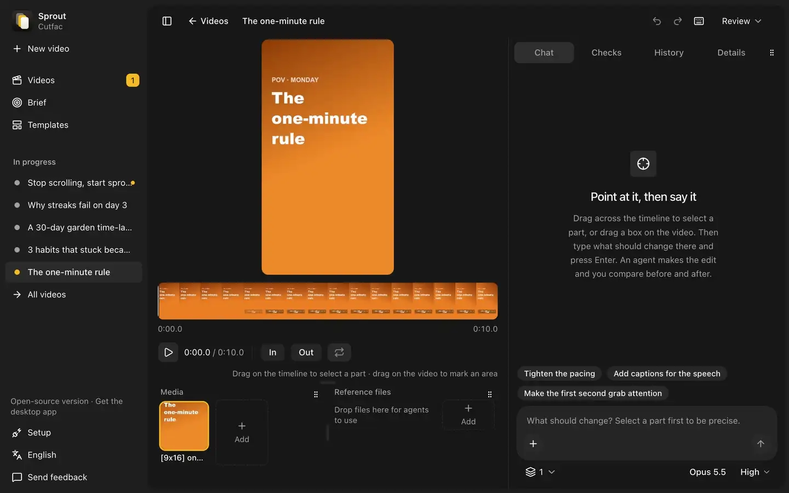

<p align="center">
  <picture>
    <source media="(prefers-color-scheme: dark)" srcset=".github/assets/logo-dark.svg">
    
  </picture>
</p>

<h1 align="center">Cutfac</h1>

<p align="center">
  <a href="LICENSE"></a>
  
  
  
</p>

<div align="center">
  <strong>
    Cutfac is a local-first studio for short-form marketing videos, made for solo developers who market their own app. Your own coding agent does the work, and you review it on a board.
    <br /><br />
    Get the signed Mac app, or build the open-source edition yourself.
  </strong>
</div>

<p align="center">
  <br />
  <a href="#quick-start"><strong>Quick start »</strong></a>
  <br /><br />
  <a href="https://cutfac.com">Website</a>
  ·
  <a href="docs/architecture.md">Architecture</a>
  ·
  <a href="https://github.com/w00ing/cutfac/issues">Issues</a>
  ·
  <a href="https://wyverselabs.com">Wyverse Labs</a>
</p>

<p align="center"><strong>Made for:</strong></p>
<p align="center">
  
  
  
</p>

<p align="center"><strong>With your own agent:</strong></p>
<p align="center">
  
  
  
</p>

<br />

<p align="center">
  
</p>

## ✨ Features

- **Point at what to change.** Drag across the timeline to pick a part, draw a box on the video, and
  say what should change. Your agent edits the file, then you compare before and after and keep it
  or restore the old one.
- **One board for every post.** Each video moves from drafting to review to done, with timecoded
  feedback and upload checks along the way.
- **Teach it what you make.** Paste a link to your site, your store page or a video you like, or
  pick the folder you work in. Cutfac saves a first look into `about.md` (for a video, its
  scene cuts, hook frames, contact sheet and audio), your agent reads the rest, and every run after
  that knows your product. The patterns that work become reusable formats.
- **Agents check their own work.** Your agent writes a brief and shot list for you to okay before
  it renders, then looks at the frames it made, every cut included, and fixes the biggest problems
  first.
- **Templates from any link.** Paste a post, a repo or an Agent Skill and the board runs your agent
  on it, turning it into a template with its own inputs and previews. The agent can only read until
  you press Allow, and the board shows what each template still needs. See
  [docs/templates.md](docs/templates.md).
- **Bring your own agent.** Claude Code and Codex connect through the built-in MCP server and run
  on your machine, with the model and reasoning effort you pick in the chat. Without one, "Copy
  prompt" hands the request to any agent you like.
- **Files, not a database.** A workspace is plain folders and YAML, so it works with Git, Finder and
  your editor.
- **English and Korean.**

<p align="center">
  <picture>
    <source media="(prefers-color-scheme: dark)" srcset=".github/assets/board-dark.png">
    
  </picture>
</p>

<p align="center">
  <picture>
    <source media="(prefers-color-scheme: dark)" srcset=".github/assets/templates-dark.png">
    
  </picture>
</p>

## Mac app vs. open source

The Mac app, Cutfac Solo, is built from this repository. Both have the same features, and
we don't lock any of them behind a license key. Paying gets you a signed build that updates itself,
plus content we prepare for you.

| Area                                             | Solo (Mac app)                                    | Open source (this repository)                  |
| ------------------------------------------------ | ------------------------------------------------- | ---------------------------------------------- |
| **Cost**                                         | $19/month or $180/year, 7-day free trial          | Free forever (AGPL-3.0)                        |
| **Setup**                                        | Download a signed app and open it                 | Install Bun and ffmpeg, then build it          |
| **Updates**                                      | Install themselves                                | Pull and rebuild                               |
| **Board, editor, learning, formats, MCP server** | Included                                          | Included                                       |
| **Agents**                                       | Your own Claude Code or Codex, on your machine    | Your own Claude Code or Codex, on your machine |
| **Reference feed and format packs**              | Included once they ship                           | Not included                                   |
| **Data**                                         | Plain folders on your Mac                         | Plain folders on your machine                  |
| **If you stop paying**                           | The app keeps working at the last version you had | Not applicable                                 |
| **Source and changes**                           | Built from this repository                        | Fork and modify under the AGPL-3.0             |

## Privacy

- This repository is the open-source edition of Cutfac. The Mac app is built from the same
  code.
- Your workspace stays on your disk. There's no account and no telemetry, and your videos and files
  are never uploaded.
- Agents run on your machine with your own Claude Code or Codex login. Cutfac never asks
  for, stores or forwards your API keys.
- The server listens on `127.0.0.1` unless you pass `--host`, and refuses requests that other
  websites send it from your browser. [SECURITY.md](SECURITY.md) covers how to report a problem.
- It only goes online when you ask it to: learning from a link (videos through your own `yt-dlp`)
  or sending feedback to the Cutfac team (your message, an optional reply address, and the app's
  version, platform and language). The Mac app also checks cutfac.com for updates, sending your
  license key and nothing about your workspace.
- Learn from videos you're allowed to download, and don't repost other people's videos.

## Tech stack

- [Bun](https://bun.sh) for the runtime, server, tests and the compiled sidecar
- [Effect](https://effect.website) v4 for the core and the server
- React 19, Vite, Tailwind CSS v4 and [shadcn/ui](https://ui.shadcn.com), with the React Compiler
- Electron for the Mac app
- ffmpeg and ffprobe for media, with optional `yt-dlp` and `whisper`
- oxlint and oxfmt

## Requirements

Bun 1.3+, ffmpeg/ffprobe. Optional: `yt-dlp` (video links), `whisper` (transcripts).

## Quick start

```sh
bun install && bun run build
bun src/cli.ts init ~/my-app-content
bun src/cli.ts serve --workspace ~/my-app-content       # http://localhost:4317
```

`init` connects your agents. Claude Code gets a project-scoped `.mcp.json` in the workspace, and
Codex is registered through `codex mcp add` as `cutfac-<workspace>`. Until an agent is
connected, the web UI opens on a Setup page that connects one. Use `--no-connect` to only print the
agent commands. To teach it about your product, use the board's Learn page, ask your agent, or run
`cutfac learn <link or path>`; store links on a landing page are followed. To adopt an existing folder of posts,
add a `cutfac.yaml` with `paths.items` pointing at it and ask your agent to bring each post in; it
calls `create_item` with the post's folder as the id, which writes an `item.yaml` there.

The workspace gets the `cutfac` skill in `.agents/skills/` and `.claude/skills/`. `serve`
and the MCP server bring it up to date when Cutfac changes it. A copy you edited is kept,
and your agent offers you the new version instead.

`serve` takes `--port` (default 4317), `--host` (default `127.0.0.1`), and `--web-dir` to serve a
web build other than `dist/web`.

## Editing a video

Open an item on the board. Drag across the timeline to select a part (or press `I` and `O` at the
playhead), drag on the video to mark an area, then type what should change and press Enter. A box
you draw opens a small request box right beside it, so you can ask about it without leaving the
frame. The server runs `claude -p` or `codex exec` in the workspace, one session per item, and
streams its steps into the chat. The agent gets a clip of the range, the frame with the box drawn
on it, the timecodes, and the original file. When it is done, compare before and after, then keep
the edit or restore the previous version. Without a connected agent, the request waits in the chat
and "Copy prompt" hands it to any agent you run yourself.

<p align="center">
  <picture>
    <source media="(prefers-color-scheme: dark)" srcset=".github/assets/editor-dark.png">
    
  </picture>
</p>

Press `+` in the chat to give the agent something to read whenever it works on the video: paste a
link or a folder or file path, or in the desktop app choose one from disk. They show as chips above
the message and are saved in `item.yaml` as `sources`. Next to the agent, pick the model and
reasoning effort it runs with; the choice is kept per agent in that browser, and each run names the
ones it used.

You don't have to wait for one request to finish before making the next. Requests made while the
agent is working line up behind its run and start in turn, each from the result of the one before.
Until its turn comes, a request can be edited or cancelled. Numbered pins on the frame and the
timeline show the requests still in play; click one to jump to it in the chat. If a run fails or
is stopped, the rest of the line holds until you press Continue or Cancel all.

Every change to an item can be undone: edits, rollbacks, and changes to its title, status, hook,
or notes, which you can edit in place in the Details tab. The History tab lists the changes
to jump back to and every saved version of each file to preview or restore.

Shortcuts: `Space` play or pause, `I`/`O` set the start or end, `L` loop the selection, `←`/`→` step
a tenth of a second (`Shift` for a second), `Esc` clear, `⌘Z`/`⇧⌘Z` undo or redo a change to the
item (`Ctrl+Z`/`Ctrl+Y` elsewhere), and `?` shows them all.

## Desktop app

```sh
bun run desktop           # build the web UI and Electron shell, then open it
bun run dist:desktop      # unsigned macOS app in release/, with the server compiled as a sidecar
bun run release:desktop   # signed and notarized release, uploaded to the private release bucket
```

The app runs the same server as `cutfac serve` as a sidecar on `127.0.0.1` and opens the board in
its window.

### Updates

The released app checks its feed at launch and every four hours, downloads a newer version in the
background, and offers to restart once it is ready. Choosing Later installs it the next time the app
quits. The app menu also has Check for Updates… and License Key….

The feed is served by cutfac.com, which needs the license key from checkout with every request. The
app keeps the key in its settings and sends it to cutfac.com only. Without a key, or with one whose
plan has ended, the app keeps working at its version and stops updating. Runs from source (`desktop`,
`desktop:dev`) never update.

### Releasing the app

`release:desktop` reads its credentials from `.env.release`, which git ignores:

- `APPLE_ID`, `APPLE_APP_SPECIFIC_PASSWORD`, `APPLE_TEAM_ID` to notarize
- `CUTFAC_RELEASES_BUCKET`, `CUTFAC_RELEASES_REGION` for the private S3 bucket the builds go to
- `AWS_ACCESS_KEY_ID`, `AWS_SECRET_ACCESS_KEY` for a user that can read and write `mac/` in it

Give that user only `s3:PutObject`, `s3:GetObject` and `s3:AbortMultipartUpload` on the bucket's
objects and `s3:ListBucket` on the bucket, which lets the first release see that no feed exists yet.
It never deletes or changes bucket settings. The site holds no AWS key: it signs CloudFront links,
and only that distribution may read the bucket.

It also needs a Developer ID Application certificate in the keychain. Bump `version` in
`package.json` first: the script refuses a version that is not newer than the published one. It
builds, signs under the hardened runtime, notarizes, and uploads the dmg, the zip and their
blockmaps to `mac/`, then `latest-mac.yml` last so no app sees the release before its files.
cutfac.com hands out short-lived CloudFront links to these files: the dmg from its download page and
the rest to the app's update checks, each for a live license key. The feed is never cached and build
files never change, so a release needs no cache invalidation.

Commit before you release: the script refuses changes a build would pick up and a version that is
already tagged, so every release matches a commit. After the upload it tags that commit
`v<version>`, pushes the tag, and creates a GitHub release with no files attached, whose notes list
the features and fixes since the last tag. That step needs `gh` logged in. If it fails, the builds
are already out and the script prints the commands left to run.

The feed is the `publish` url in `electron-builder.yml`, and every build keeps the URL it was built
with. To move the feed, publish one release that points to the new place while the old one keeps
serving.

To sign and ship your own build, put your own Apple account, bucket and key in `.env.release` and
point the `publish` url at a feed you serve. The app fetches `latest-mac.yml` from that url, with
the files it names next to it, and sends a license key only when one is saved in the app.
`dist:desktop` builds stay unsigned and need none of this.

### Feedback

People can tell the Cutfac team something three ways: "Send feedback" in the sidebar, a message
that starts with `/feedback` in the editor's message box, the box prompt or the import chat (it goes
to the team, not the agent), or by asking their agent, which calls the `send_feedback_to_cutfac` MCP
tool. Agents that list MCP prompts as commands also offer the `feedback` prompt,
`/mcp__cutfac__feedback` in Claude Code, which takes the message after it or asks for one. The
agent shows them the exact text and sends it only once they agree. The board posts to
`/api/team-feedback`; the MCP tool sends from the MCP server itself. Either way
`https://cutfac.com/api/feedback` gets the message, an optional reply address, the app's version,
platform and language, which way it came, and the agent, if one was involved. Nothing else is sent.

## Workspace layout

```
cutfac.yaml             name, paths, default agent
about.md                what agents read about the product, audience, and voice, one section per source
learned/<id>/           learned.yaml and a first look: pictures, or a video with frames/, contact.jpg, audio.wav
formats/<id>/           format.yaml, README.md, previews and choice files, optional template/
items/<id>/             item.yaml, brief.md, shotlist.md, [9x16] video.mp4, [9x16] cover.jpg, …
items/<id>/review/      frames, a contact sheet and cut strips of each video, from review_media
items/<id>/history/     history.yaml: the undo stack and every saved version of the media
```

## Development

```sh
bun run serve -- --workspace <dir>   # API on :4317
bun run dev:web                      # Vite on :5173, proxies /api and /files
bun run desktop:dev                  # the desktop app on live code
bun test && bun run typecheck && bun run lint
```

`desktop:dev` opens the desktop app on free ports. The board hot-reloads, the server restarts
itself when `src/` changes, and the app restarts when `electron/` changes. A server restart cuts
off any agent run in progress. Closing the app or Ctrl+C stops everything.

See [docs/architecture.md](docs/architecture.md) for the design and the hosted roadmap, and
[docs/templates.md](docs/templates.md) for the template spec.

To send a change, see [CONTRIBUTING.md](CONTRIBUTING.md).

## License

Cutfac is licensed under the [GNU Affero General Public License v3.0](LICENSE).
