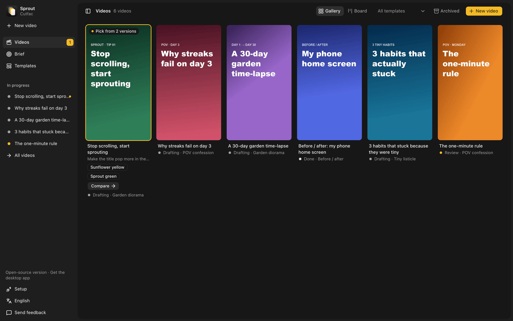
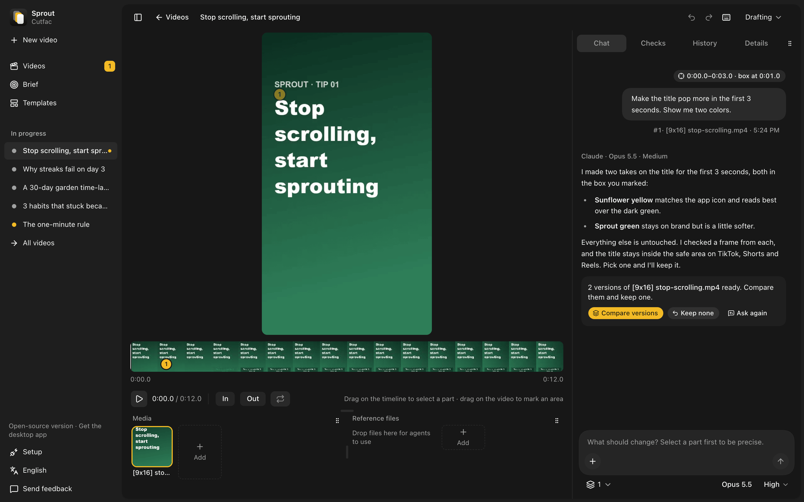
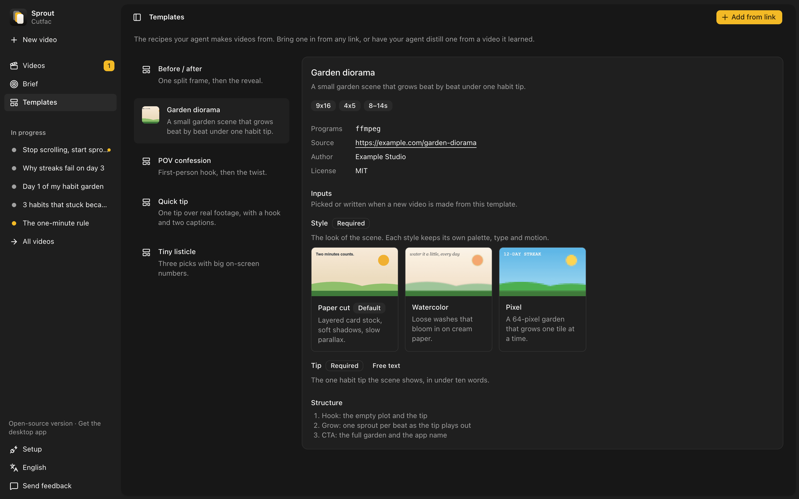

<p align="center">
  <picture>
    <source media="(prefers-color-scheme: dark)" srcset=".github/assets/logo-dark.svg">
    
  </picture>
</p>

<h1 align="center">Cutfac</h1>

<p align="center">
  <a href="LICENSE"></a>
  
  
  
</p>

<p align="center">
  <strong>A local-first studio for short-form videos. Your own coding agent makes them; you point at what to change.</strong>
</p>

<p align="center">
  <a href="#quick-start"><strong>Quick start »</strong></a>
  ·
  <a href="docs/architecture.md">Architecture</a>
  ·
  <a href="https://github.com/wyverselabs/cutfac/issues">Issues</a>
</p>

<p align="center">
  
  
  
  
  
</p>

<p align="center">
  
</p>

## Features

- **Point at what to change.** Select a part of the timeline or draw a box on the video, then say
  what to change. Compare before and after, and keep it or undo it.
- **Ask for versions.** Get a few takes of one change and keep the best.
- **One board for every video**, from drafting to review to done.
- **Templates from any link.** Turn a post, a repo or an Agent Skill into a reusable template.
- **Teach it your product.** Paste a link or pick a folder, and every video after fits it.
- **Your own agent.** Claude Code or Codex runs on your machine through the built-in MCP server.
- **Plain files.** A workspace is folders and YAML, so Git, Finder and your editor all work.
- **English and Korean.**

<p align="center">
  
</p>

<p align="center">
  
</p>

<p align="center">
  
</p>

<sub>Demo footage from Pexels by Tuğba, RDNE Stock project, Santiago Peña Bossano, Annushka Ahuja,
Oksana Kyzyma and Sergei Starostin.</sub>

## Quick start

Install [Bun](https://bun.sh) 1.3+ and ffmpeg, then:

```sh
bun install && bun run build
bun src/cli.ts init ~/my-videos                       # make a workspace and connect your agents
bun src/cli.ts serve --workspace ~/my-videos          # open http://localhost:4317
```

`init` connects Claude Code (a `.mcp.json` in the workspace) and Codex (`codex mcp add`); pass
`--no-connect` to only print the commands. Optional: `yt-dlp` to learn from video links and
`whisper` for transcripts.

## Editing a video

Open a video, drag across the timeline to pick a part, drag on the video to mark an area, and type
what should change. Your agent gets the clip, the marked frame and the timecodes, edits the file,
and streams its steps into the chat. Then compare and keep or restore. Set how many versions to
make next to the message box to compare several takes.

Requests made while the agent works line up and run in turn. Every change can be undone, and the
History tab keeps each saved version. Press `?` for shortcuts.

## Mac app or from source

The signed Mac app at [cutfac.com](https://cutfac.com) is built from this repository, so both have
every feature; nothing is held back from the source. The app saves you the build and keeps itself up
to date.

|         | Signed Mac app                        | Built from source                  |
| ------- | ------------------------------------- | ---------------------------------- |
| Cost    | First 3 videos free, then a paid plan | Free under the AGPL-3.0, no limit  |
| Setup   | Download it and open it               | Install Bun and ffmpeg, then build |
| Updates | Install themselves                    | Pull and rebuild                   |

## Privacy

- Your videos and files stay on your disk. No account, no usage analytics.
- The Mac app asks once whether to send error reports. Only if you agree does it report its
  failures to the Cutfac team through PostHog, never your videos, prompts or chats. Settings turns
  them off. Builds from source never send any.
- The Mac app keeps a log in `~/Library/Logs/Cutfac` to help trace problems. It stays on your Mac
  unless you send it with feedback, and entries older than 7 days are deleted
  ([details](docs/desktop.md#logs)).
- Agents run with your own Claude Code or Codex login. Cutfac never sees your API keys.
- The server listens on `127.0.0.1` unless you pass `--host`, and refuses requests from other
  websites.
- It goes online only when you ask: learning from a link, or sending feedback. The Mac app also
  checks for updates, with a license key whether the plan is active, and sends the error reports
  you agreed to.
- Learn only from videos you're allowed to download.

See [SECURITY.md](SECURITY.md) to report a problem.

## Development

```sh
bun run serve -- --workspace <dir>   # API on :4317
bun run dev:web                      # Vite on :5173
bun run desktop:dev                  # the Mac app on live code
bun test && bun run typecheck && bun run lint
```

Built with Bun, Effect v4, React 19, Vite, Tailwind CSS v4, shadcn/ui and Electron.

- [docs/architecture.md](docs/architecture.md): how it fits together, and the workspace layout
- [docs/templates.md](docs/templates.md): the template format
- [docs/desktop.md](docs/desktop.md): the Mac app, updates, releasing and feedback
- [CONTRIBUTING.md](CONTRIBUTING.md): sending a change

## License

[GNU Affero General Public License v3.0](LICENSE). The Cutfac name, logo and icon are trademarks of
Wyverse Labs and aren't covered by the license, so a build you distribute needs its own name and
icon. [TRADEMARKS.md](TRADEMARKS.md) says what's fine and how to make a fork.
